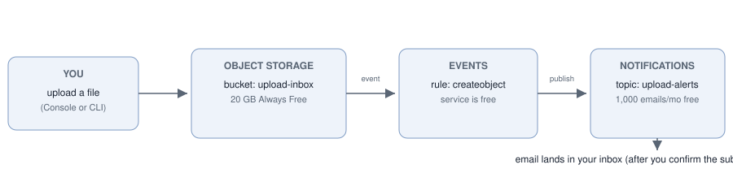

# oci-ootb-upload-alerts

An OOTB (out-of-the-box) OCI project: a working file-upload alert pipeline built **only from Oracle Cloud's built-in services** - no custom servers, no Functions, no code running anywhere. You configure three managed features and they do the work:

**Upload a file to an Object Storage bucket -> an Events rule catches it -> a Notifications topic emails you.**



| Built-in OCI feature | Role here | Cost |
|---|---|---|
| Object Storage bucket (`upload-inbox`) | Receives uploads | 20 GB Always Free |
| Events rule (`upload-inbox-create-events`) | Matches `com.oraclecloud.objectstorage.createobject` on that bucket | Events service is free |
| Notifications topic (`upload-alerts`) + EMAIL subscription | Sends you the alert | 1,000 emails/month free (1M HTTPS deliveries free) |

Cost sources: [Always Free resources](https://docs.oracle.com/en-us/iaas/Content/FreeTier/freetier_topic-Always_Free_Resources.htm), [Events pricing](https://www.oracle.com/cloud/events-service/), [Notifications pricing](https://www.oracle.com/cloud/cloud-native/notifications/pricing/). Verified 27 October 2026.

## Status: prepared, not deployed

This repository contains the deploy-ready configuration and an offline validator that checks the configs are consistent (`scripts/validate.py`, with tests and CI). **Nothing here has been deployed: no OCI resources exist for this project yet.** Deploying runs commands in your own tenancy - see [docs/setup.md](docs/setup.md). The resources above are Always Free-eligible in the home region, but creating them is your call on your account.

## Why this is "OOTB"

Every moving part is a feature OCI already ships: buckets emit events, the Events service routes them, Notifications delivers them. The project is the configuration that wires them together, plus docs and tests - there is deliberately no application code to maintain.

## Layout

- `config/events-rule.json` - Events rule create-request body, with `<compartment-ocid>` and `<notifications-topic-ocid>` placeholders you fill at deploy time.
- `config/notifications-topic.json` - topic and EMAIL subscription shape, with `<your-email-address>` placeholder.
- `scripts/validate.py` - offline consistency check (exit 0 ok, 1 bad input, 2 findings).
- `docs/setup.md` - step-by-step deploy, verify and cleanup, both Console and OCI CLI.
- `assets/architecture.svg` - the diagram above.
- `tests/` - unittest suite for the validator, config shapes and assets.

## Run the checks

```
python3 scripts/validate.py
python3 -m unittest discover -s tests -v
```

## Honest limits

- Not deployed or tested against a live tenancy; the CLI commands in the docs follow the published OCI CLI reference but have not been executed here.
- Email subscriptions start Pending: the first alert only arrives after you confirm the subscription email once. That confirmation step is OCI's built-in behavior, not something this project controls.
- Events are at-least-once: a duplicate alert email is possible in rare retry cases.
- Free-tier numbers above are Oracle's published Always Free / free-allocation limits as of 27 October 2026 and can change; the docs links are the source of truth.
